

  

<h1 align="center">XO Lab – E-commerce Performance Report</h1>

<table align="center">
  <tr>
    <td width="1440" align="justify">
      <h2 align="center">Business Background</h2>
      

        XO Lab is a US-based e-commerce company specializing in consumer electronics and gaming support accessories for a global customer base. Since its establishment in 2018, the company experienced rapid growth, fueled largely by the shifting market dynamics of the COVID-19 pandemic.
          
        Between 2019 and 2022, XO Lab generated over <strong>100K orders</strong> from approximately <strong>88K customers</strong>, resulting in more than <strong>$28 million in revenue</strong>. This dataset captures key business dimensions, including sales, product performance, and operational metrics across loyalty segments, regional performance, and marketing channel.
      

      <h2 align="center">Objective</h2>
      

        This analysis evaluates XO Lab’s four-year (2019–2022) business performance to identify key growth drivers and operational challenges. The goal is to deliver actionable insights that support data-driven decision-making across cross-functional teams.
          
        The primary <strong>north star metric</strong> is <strong>year-over-year (YoY) revenue growth</strong>, supported by the following analytical areas:
      

      

        <ul>
          <li><strong>Sales Trends</strong> Revenue trends, average order value (AOV), and order volume.</li>
          <li><strong>Product Performance</strong> Top-performing products, revenue contribution, and refund rates.</li>
          <li><strong>Operational Performance</strong> Loyalty program performance, regional performance and marketing channel effectiveness.</li>
        </ul>
      

    </td>
  </tr>
</table>
      <h1 align="center">Executive Summary</h1>
      

        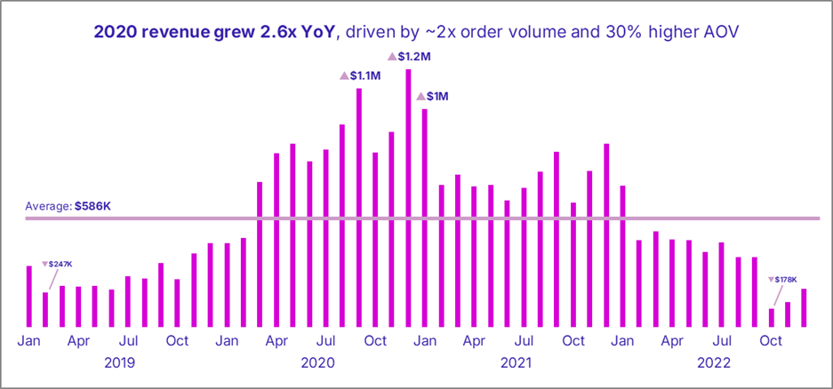
      

       
      

        XO Lab experienced a clear business lifecycle: <strong>hypergrowth in 2020, stabilization in 2021</strong>, and <strong>decline in 2022</strong>, reflecting pandemic-driven demand shifts and post-pandemic normalization.
      

       
<table align="center">
  <tr>
    <td width="720" valign="top" align="justify">
      <ol>
        <li>
          <strong>Sales Performance &amp; Trends</strong>
          <ul>
            <li>2020 marked peak performance with <strong>~$10.2M revenue (+163% YoY),</strong> driven by <strong>doubling order volume growth</strong> and <strong>higher AOV (+30%)</strong>.</li>
            <li>Strong acceleration toward year-end, with <strong>Q4 2020 contributing ~30%</strong> of annual revenue in 2020 making it the best-performing quarterly sales revenue.</li>
            <li>Growth was primarily driven by <strong>pandemic-induced demand shifts</strong>, not sustainable business expansion, where lockdowns accelerated e-commerce adoption, increased online transactions, and encouraged higher basket sizes.</li>
          </ul>
        </li>
        <li>
          <strong>Seasonality Pattern</strong>
          <ul>
            <li><strong>Q3–Q4 dominated in 2019–2020</strong>, though this seasonal pattern weakened in 2021–2022, suggesting a structural shift in buying behavior.</li>
            <li>Indicates <strong>revenue is volume-driven</strong>, likely influenced by promotional cycles and holiday demand (e.g. Black Friday, Christmas Sales).</li>
            <li>Seasonality pattern remains stable across years except in 2022.</li>
          </ul>
        </li>
        <li>
          <strong>Declining Trend in 2022</strong>
          <ul>
            <li><strong>Revenue declined by 46% YoY</strong>, primarily driven by a 40% drop in order volume, indicating a significant loss in all products demand rather than pricing inefficiency.</li>
            <li>Q4 2022 underperformed despite historically being the strongest quarter, breaking the usual seasonal pattern.</li>
            <li>This trend is consistent with post-pandemic behavior indicating <strong>demand is no longer pandemic-driven</strong>, where consumers shifted back to offline channels and reduced online spending, potentially compounded by competition or internal business.</li>
          </ul>
        </li>
      </ol>
    </td>
    <td width="720" valign="top" align="justify">
      <ol start="4">
        <li>
          <strong>Key Takeaways</strong>
          <ul>
            <li>Sales Performance: Revenue peaked in 2020 (~$10.2M ,+163% YoY), with Q4 contributing ~30% of the year’s total. <strong> Growth was primarily volume-driven</strong>, boosted by pandemic-era e-commerce demand.</li>
            <li>Seasonality: Q3-Q4 contributed 55%+ of annual revenue in 2019-2020, but this pattern weakened in 2021 and broke in 2022, signaling demand weakness.</li>
            <li>Revenue fell 46% YoY on a 40% drop in order volume, and Q4 underperformed, suggests weakening demand beyond post-pandemic normalization, potentially amplified by heavy reliance on the Direct channel and customer retention issues.</li>
          </ul>
        </li>
        <li>
          <strong>Recommendations</strong>
          <ul>
            <li><strong>Product & Seasonality:</strong> To recover order volume, introduce cross-category bundles (laptop/monitor with headset and underperforming accessories) with tiered discounts for multi-item purchases, and rebuild the Q3-Q4 season through a mass-campaign discount week launched ahead of Q3.</li>
            <li><strong>Promote (Marketing Channel)</strong>: Reduce dependence on the direct channel, by promoting product-bundling through another channel, such as email (solid volume, 18.5K orders) and affiliate (highest AOV, ~$303).</li>
            <li><strong>Focused Region & Marketing Channel</strong>: Concentrate email and affiliate efforts on North America and EMEA, the top two regions by revenue and order volume with solid AOV, and run a smaller APAC test given its AOV premium.</li>
            <li><strong>Loyalty Program</strong>: Convert first-time buyers into loyalty members through post-purchase email flows, since loyalty members generated more than half of revenue and volume in 2021–2022 and now sustain the business.</li>
          </ul>
        </li>
      </ol>
    </td>
  </tr>
</table>

</table>
<h2 align="center">Dataset Structure and ERD (Entity Relationship Diagram)</h2>
<body>The database structure as seen below consists of four tables: order, customer, geo_lookup, and order_status, with a total row count of 108.124 records.
</body>

  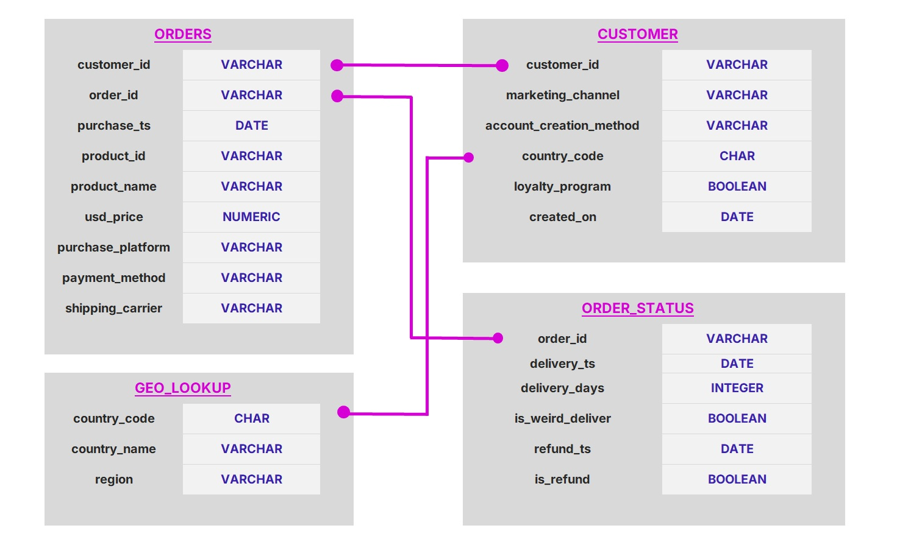

<table align="center">
  <tr>
  <h1 align="center">Insights</h1>
    <td width="1440" colspan="2">
      <h2 align="center">Sales Performance Overview</h2>
    </td>
  </tr>
  <tr>
    <td align="center" width="720">
      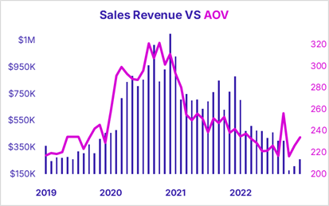
    </td>
    <td align="center" width="720">
      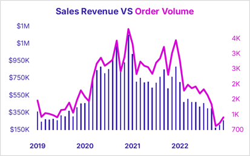
    </td>
  </tr>
</table>

<table align="center">
  <tr>
    <td width="1440" align="justify">
      <h3 align="center">Sales Revenue</h3>
      

        <ol>
          <li>
            2020–2021: COVID-19 tailwind drove 163% peak growth, sustaining a new revenue baseline
            <ul>
              <li>Revenue grew from <strong>$3.9M (2019) to $10.2M in 2020</strong> making it a <strong>163% YoY increase</strong>, driven by accelerated e-commerce adoption tied to work-from-home behavioral shifts in pandemic COVID-19 era.</li>
              <li>Growth momentum began in <strong>March 2020 (+50% MoM)</strong> and sustained through Q4, with monthly revenue consistently reaching <strong>$850K–$1.25M</strong> in 2nd half of 2020, roughly <strong>2.7x the same months in 2019.</strong></li>
              <li>2021 held a structurally higher baseline at <strong>$9.1M (-10% YoY),</strong> with monthly revenue stabilizing in the <strong>$631K–$1.03M</strong> range indicating a post-peak normalization.</li>
            </ul>
              <li>
                Q3–Q4 seasonality held from 2019 to 2021, then structurally broke in 2022
                <ul>
                  <li>From 2019 to 2021, <strong>Q3–Q4 consistently outperformed on holiday-driven demand</strong> (Black Friday, Christmas), making seasonality a reliable planning anchor.</li>
                  <li>That pattern broke sharply in 2022<strong>: Q4 2022 recorded just $649K</strong>, down 71% YoY from $2.28M in Q4 2021 making it the <strong>lowest quarterly</strong> <strong>result</strong> across the entire four-year period<strong>.</strong></li>
                  <li><strong>Revenue declined across every quarter in 2022</strong>, with full-year revenue falling to $5.0M (-46% YoY), a pace of decline that exceeds typical post-pandemic normalization.</li>
                </ul>
              </li>
              <li>
                2022 signals a structural problem and demands a focused diagnosis
                <ul>
                  <li>The 2022 trajectory is not consistent with a demand correction alone, a -46% annual decline that steepens in Q4 points to <strong>possible customer retention failure</strong>, <strong>competitive displacement</strong>, or a <strong>product-market fit</strong> that was pandemic-specific.</li>
                  <li>This requires further analysis on retention cohorts, acquisition channels, and product mix to isolate the root cause.</li>
                </ul>
              </li>
            </ol>
          </li>
        </ol>
      

      <h3 align="center">Average Order Value (AOV)</h3>
      

        <ol>
          <li>
            2020 AOV expansion amplified revenue growth, followed by normalization in 2021–2022
            <ul>
              <li>AOV increased from <strong>$230 (2019) to $300 (2020)</strong> (+30% YoY) reflecting higher spending per transaction driven by pandemic-related home setup demand.</li>
              <li>Growth was consistent across all quarters in 2020, peaking at <strong>$311 in Q4</strong>, with multiple months exceeding $300, well above the 2019 range ($217–$246).</li>
              <li>AOV declined to $255 in 2021 (-15% YoY) signaling the beginning of post-pandemic normalization. This downward trend continued into 2022, with AOV returning to the <strong>pre-pandemic baseline of $230</strong>.</li>
            </ul>
          </li>
          <li>
            2022 AOV reset indicates a return to baseline purchasing behavior
            <ul>
              <li>By 2022<strong>, AOV fully reverted to 2019 pre-pandemic baseline</strong>, suggesting that pandemic-driven basket expansion was not structurally sustained.</li>
              <li>Monthly AOV 2022 showed <strong>high volatility</strong>, fluctuating from <strong>$217 (Aug) to $256 (Sep) to $216 (Oct)</strong>, indicating short-term fluctuations rather than consistent growth.</li>
              <li>Q4 2022 AOV remained significantly below prior years, highlighting weaker holiday spending per transaction.</li>
              <li>Over the four-year period<strong>, AOV changes were relatively modest compared to fluctuations in order volume</strong>, indicating that revenue performance is primarily volume-driven rather than price-driven.</li>
            </ul>
          </li>
        </ol>
      

      

        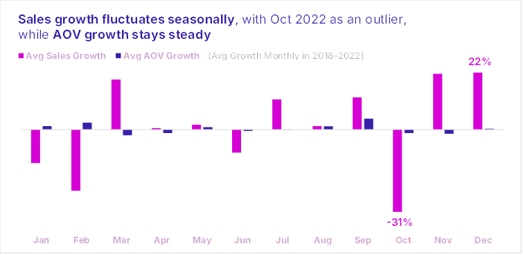
      

      <h3 align="center">Order Volume</h3>
      

      <h4 align="center">Order volume was the primary driver of revenue hypergrowth and the collapse</h4>
      

        <ol>
          <li>In 2020, order volume increased from <strong>16.8K (2019) to 33.9K (2020)</strong> (+101% YoY), effectively doubling and acting as the main contributor to the <strong>+163% revenue growth</strong> in the same period.</li>
          <li>Order volume reached <strong>35.9K in 2021 (+6% YoY)</strong>, surpassing 2020 despite declining AOV, indicating sustained customer activity post-peak pandemic, <strong>customer engagement and purchase frequency remained relatively resilient</strong>.</li>
          <li>Order volume dropped significantly to <strong>21.6K (-40% YoY) in 2022</strong>, it was the <strong>primary driver</strong> of the <strong>-46% revenue contraction</strong>. The decline was consistent across all quarters, with <strong>Q4-2022 falling to just 2.9K orders</strong>, the lowest quarterly performance in the four-year period.</li>
          <li>This breakdown in volume, particularly during the peak season, indicates <strong>weak demand recovery, potential customer churn, or reduced acquisition effectiveness</strong>.</li>
        </ol>
      

    </td>
  </tr>
</table>

<table align="center">
  <tr>
    <td width="1440" colspan="2">
      <h2 align="center">Product Performance Overview</h2>
    </td>
  </tr>
  <tr>
    <td align="center" colspan="2">
      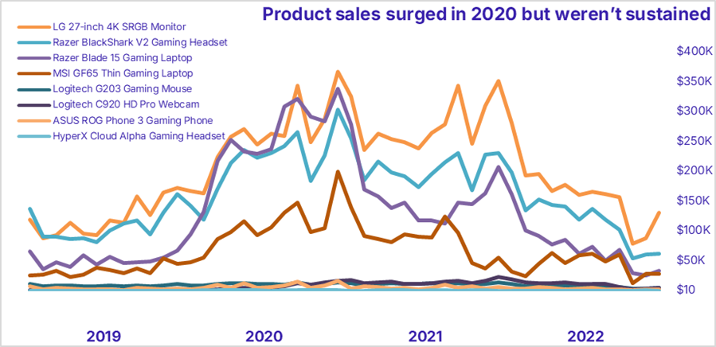
    </td>
  </tr>
  <tr>
    <td align="center" width="720">
      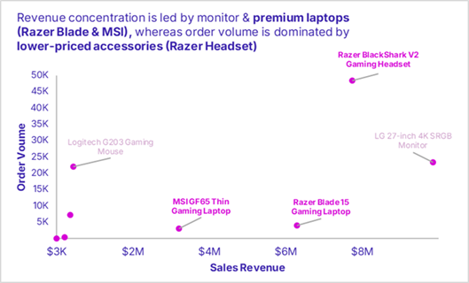
    </td>
    <td align="center" width="720">
      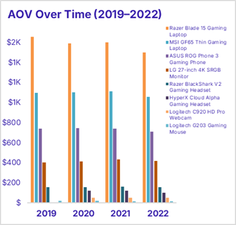
    </td>
  </tr>
</table>

<table align="center">
  <tr>
    <td width="1440" align="justify">
      <h3 align="center">Product Perfomance</h3>      
      <h4 align="center">Device product is major sales contributor, while accessories was the primary order volume contributor</h4>
        <ol>
          <li>
            Revenue is concentrated in a few high-impact products, led by premium devices
            <ul>
              <li><strong>LG 27-inch 4K Monitor is the top revenue driver</strong>, <strong>contributing ~$9.8M (35% of total revenue),</strong> despite relatively moderate order volume (~23.4K orders).</li>
              <li>Premium devices such as <strong>Razer Blade 15</strong> and <strong>MSI GF65 Thin</strong> also generate significant revenue with low order volume, indicating strong price-driven contribution. This highlights a revenue concentration risk, where <strong>a small number of high-value products disproportionately drive total sales.</strong></li>
            </ul>
          </li>
          <li>
            Accessories dominate order volume, with one product driving both volume and revenue
            <ul>
              <li>Accessories account for the majority of transactions, led by Razer BlackShark V2 Headset with <strong>~48.4K orders,</strong> the highest across all products. This product alone contributes <strong>~28% of total revenue ($7.7M),</strong> making it both <strong>a</strong> <strong>volume and revenue powerhouse.</strong></li>
              <li>Other accessories such as Logitech Mouse and Webcam generate high order volume but relatively low revenue, reinforcing <strong>that accessories are volume-driven but price-limited.</strong></li>
            </ul>
          </li>
          <li>
            2022 order volume decline was broad-based across all products
            <ul>
              <li>All products sales were going down primarily because of the declined order volume across every product in 2022 that confirms a market-wide demand contraction rather than a product issue, consistent with post-pandemic behavioral normalization where consumers shifted back to offline channels and reduced online spending.</li>
            </ul>
          </li>
          <li>
            Stable pricing limits AOV growth, while underperforming products signal portfolio inefficiency
            <ul>
              <li>Most products show <strong>low AOV variability (~5% standard deviation)</strong> across periods, indicating <strong>stable pricing with limited optimization efforts.</strong> This suggests that pricing strategy has not been actively leveraged to drive AOV growth, making <strong>pricing and bundling potential opportunities for uplift.</strong></li>
              <li>Several products (e.g., Logitech Mouse, Webcam, ASUS ROG Phone, and specifically HyperX Headset) contribute minimally to revenue despite presence in the portfolio, indicating <strong>unoptimalized product performance</strong> that require further evaluation (e.g., demand issues, positioning, or marketing effectiveness).</li>
            </ul>
          </li>
        </ol>
      

    </td>
  </tr>
</table>

<table align="center">
  <tr>
    <td width="1440" align="center">
      <h2 align="center"> Refund Rate</h2>
      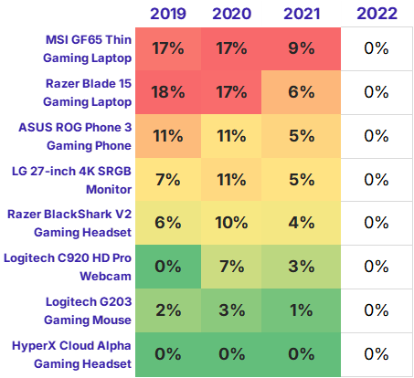
    </td>
  </tr>
  <tr>
    <td width="1440" align="justify">
      

            <strong>Refund rates peaked in 2020, improvement in 2021, and zero refund in 2022</strong>
            <ul>
              <li>Refund rates peaked in 2020 (~9% of total orders) with LG Monitor (11%) and Razer Headset (10%), alongside consistently high rates in premium laptops (~17%). This suggests that <strong>rapid demand growth may have strained product expectations or fulfillment quality</strong>, particularly for high-value items.</li>
              <li>Refund rates declined substantially across all products in 2021 (e.g., LG Monitor: 11% → 5%, Razer Headset: 10% → 4%) despite having larger order volume in the same year. This reflects <strong>improved product-market fit, better customer expectations, or enhanced operational execution</strong> following the 2020 surge.</li>
              <li>The absence of refunds across all products in 2022 is <strong>highly atypical</strong> and unlikely to reflect perfect performance. This more likely indicates <strong>data incompleteness or significantly reduced transaction volume</strong>, aligning with the sharp decline in order volume that year.</li>
            </ul>
      

    </td>
  </tr>
</table>

<table align="center">
  <tr>
    <td width="1440">
      <h2 align="center">Operational Performance</h2>
      <h3 align="center">Loyalty Status</h3>
    </td>
  </tr>
</table>

<table align="center">
  <tr>
    <td width="1440" colspan="3" align="center">
      <strong>Sales revenue dominated by non-loyalty customers by 61%</strong>
    </td>
  </tr>
  <tr>
    <td width="720" align="center">
      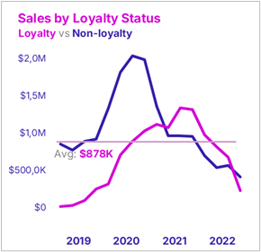
    </td>
    <td width="720" align="center">
      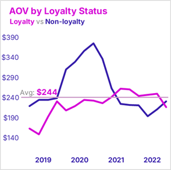
    <td width="720" align="center">
      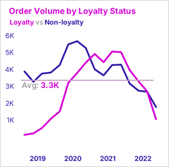
    </td>
  </tr>
</table>

<table align="center">
  <tr>
    <td width="1440" align="justify">
      

        <ol>
          <li>
            Non-loyalty customers drive higher AOV, but loyalty customers catch up over time
            <ul>
              <li>Non-loyalty customers consistently show higher AOV in early <strong>years ($344 vs $225 in 2020)</strong>, indicating stronger high-value, one-time purchases.</li>
              <li>However, the gap narrows in 2021 and reverses in parts of 2022 (e.g<strong>., Q2–Q3 2022: loyalty AOV &gt; non-loyalty),</strong> <strong>suggesting loyal customers increasingly contribute higher-value transactions over time.</strong> This indicates a shift from <strong>acquisition-driven high spend → retention-driven value extraction.</strong></li>
            </ul>
          </li>
          <li>
            Loyalty program becomes the primary driver of order volume post-2020
            <ul>
              <li>In 2019–2020, order volume is dominated by non-loyalty customers (e.g., <strong>2020: 20.8K vs 13.0K orders approx</strong>.), reflecting acquisition-led growth.</li>
              <li>Starting 2021, loyalty customers surpass non-loyalty in order volume (e.g., <strong>Q3 2021: 5.1K vs 4.3K</strong>), indicating successful <strong>customer retention and repeat purchase behavior.</strong></li>
              <li>This shift highlights the loyalty program’s role in sustaining transaction volume beyond the pandemic peak.</li>
            </ul>
          </li>
          <li>
            2022 decline driven by weakening engagement across both segments, especially loyalty
            <ul>
              <li>Both segments experienced declining order volume in 2022, but the drop is more pronounced in <strong>loyalty customers in Q4 (1.1K vs 1.8K non-loyalty)</strong>.</li>
              <li>At the same time, AOV convergence (~$220–$245 range) indicates <strong>reduced differentiation between segments</strong>, weakening the value of loyalty segmentation.</li>
              <li>This suggests <strong>erosion in customer engagement and retention effectiveness</strong>, contributing to the overall business decline.</li>
            </ul>
          </li>
        </ol>
      

    </td>
  </tr>
</table>

<table align="center">
  <tr>
    <td width="1440">
      <h3 align="center">Regional Performance</h3>
      

        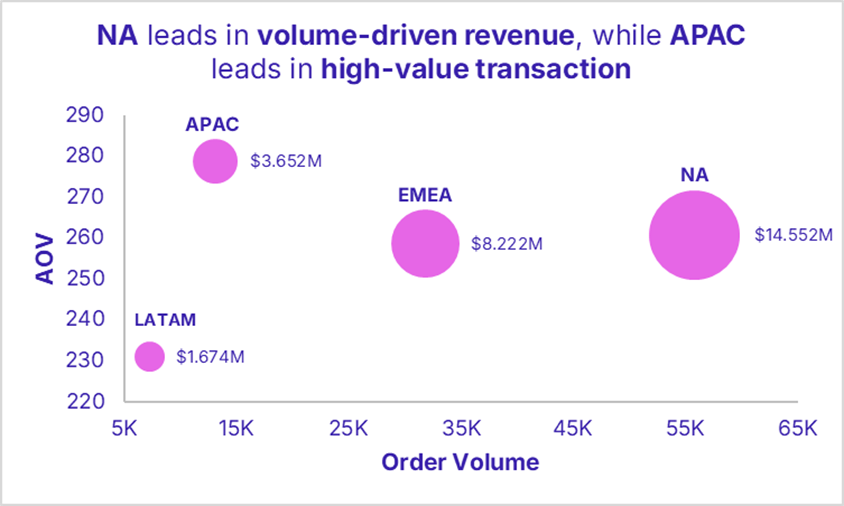
      

    </td>
  </tr>
  <tr>
    <td width="1440" align="justify">
      

        <ul>
          <li>North America (NA) is the <strong>primary revenue engine (~52% of total),</strong> driven almost entirely by scale (highest order volume ~55.8K) rather than pricing, with AOV ($261) in line with the global average.</li>
          <li><strong>APAC stands out as the highest-value region (AOV $279),</strong> indicating strong premium demand, but its low order volume (~13.1K) highlights <strong>significant untapped growth potential.</strong></li>
          <li>EMEA delivers stable, balanced performance (~$8.2M revenue, AOV $259), but lacks a clear competitive edge in either volume or value.</li>
          <li>LATAM underperforms across both demand and value (lowest AOV $231 and lowest volume ~7.2K), signaling <strong>structural limitations in market penetration and purchasing power.</strong></li>
          <li>Overall, revenue variation across regions is primarily driven by differences in order volume rather than AOV, reinforcing that <strong>growth is scale-dependent rather than price-driven.</strong></li>
        </ul>
      

    </td>
  </tr>
</table>

<table align="center">
  <tr>
    <td width="1440" colspan="2">
      <h3 align="center">Marketing Channel</h3>
    </td>
  </tr>
  <tr>
    <td width="720" align="center">
      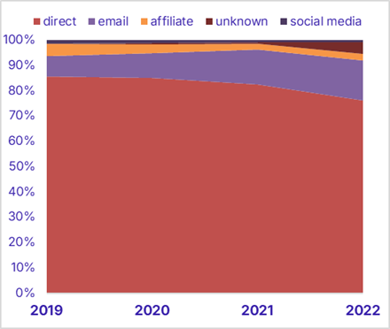
    </td>
    <td width="720" align="center">
      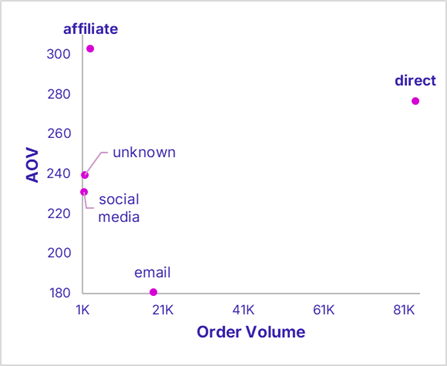
    </td>
  </tr>
  <tr>
    <td colspan="2" width="1440" align="justify">
      

        <ul>
          <li>Direct channel dominates (~83% revenue; ~78% orders), making it the <strong>primary growth driver</strong> indicating strong organic or brand-driven acquisition but also creating heavy dependency on a single channel. <strong>Over-reliance on the direct channel makes revenue highly vulnerable</strong>, so when direct traffic declines (like in 2022), total revenue drops significantly.</li>
          <li>Affiliate delivers the <strong>highest AOV (~$303)</strong> but low volume, indicating strong value per customer with <strong>underutilized scale potential</strong>.</li>
          <li>Email drives solid order volume (~18.5K) but the lowest AOV (~$181), suggesting it is <strong>effective for conversion</strong> <strong>but skewed toward lower-value transactions.</strong></li>
        </ul>
      

    </td>
  </tr>
</table>
